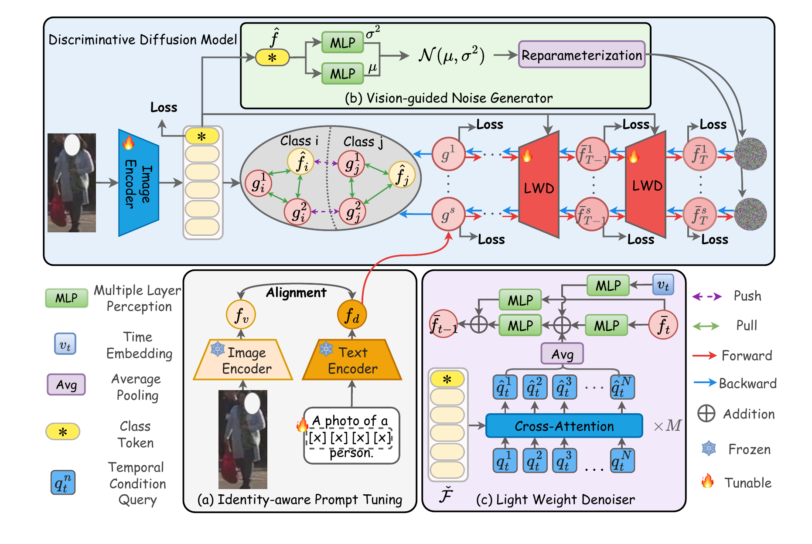
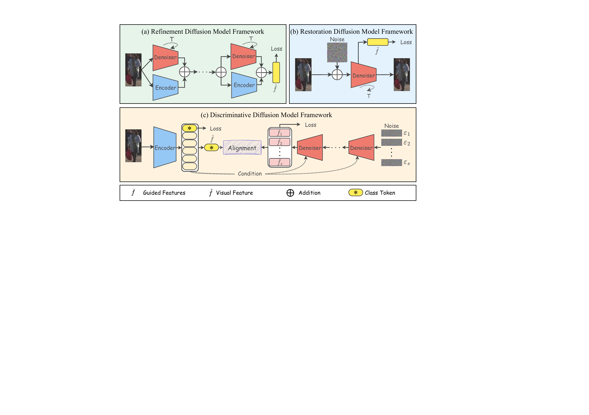
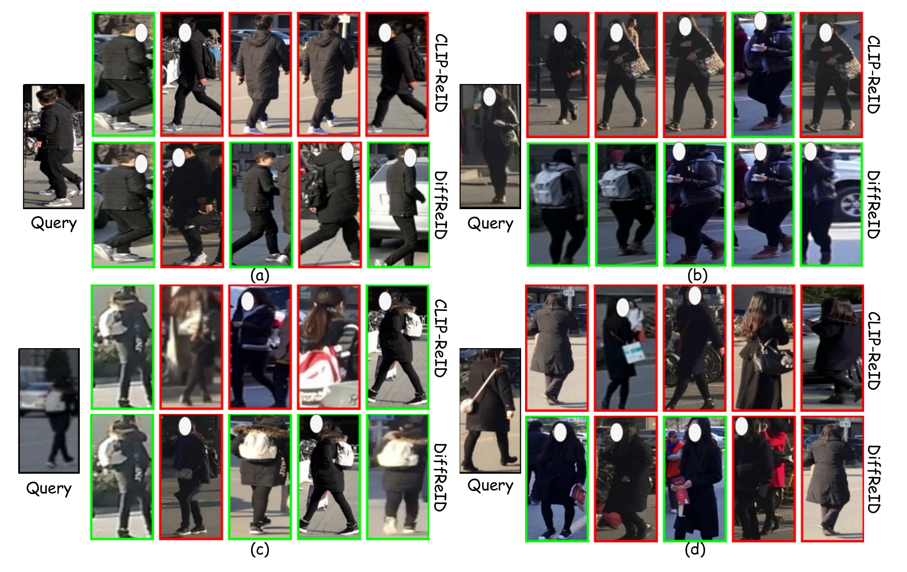
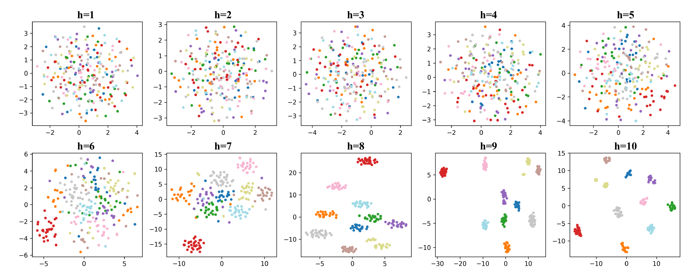
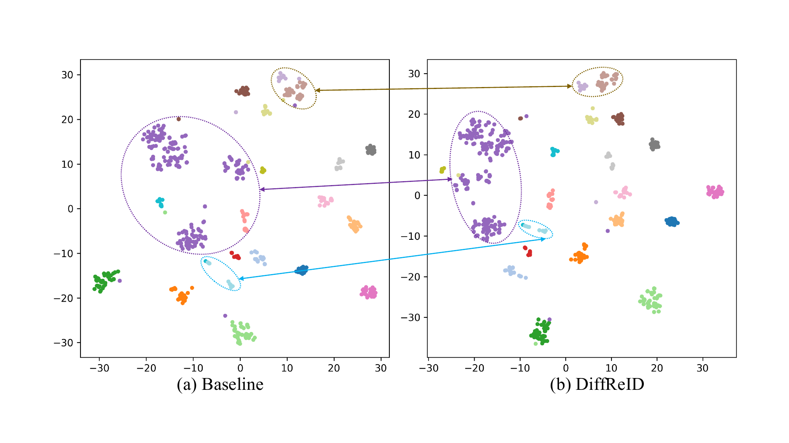
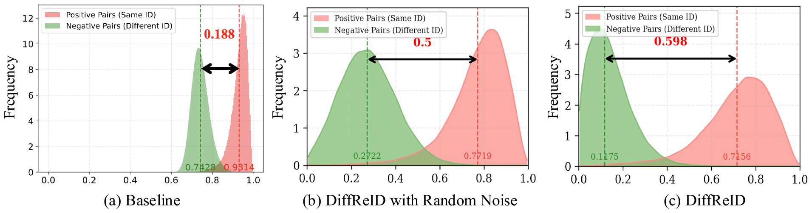
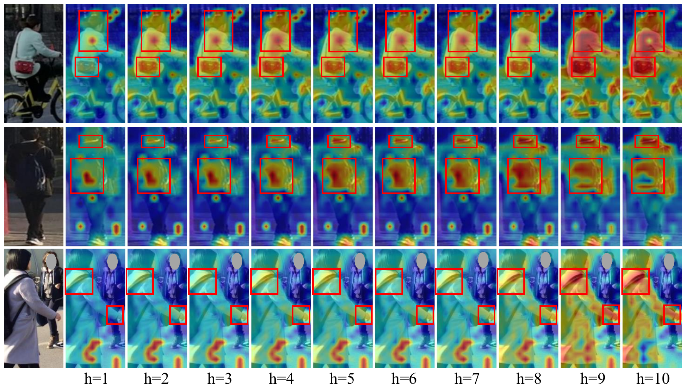

<div align="center">

# DiffReID: Discriminative Diffusion Model for Object Re-Identification

<a href="https://arxiv.org/abs/2609.36894" target="_blank">TIP 2026 Paper</a>

</div>



**DiffReID** is a generative feature learning framework for object Re-identification (ReID), which leverages a discriminative diffusion model to gradually learn identity-aware feature distributions and generate identity-invariant features. Instead of injecting noise into the backbone or relying on heavy pre-trained diffusion models, DiffReID builds a compact diffusion process in the latent space of CLIP. A Vision-guided Noise Generator initializes probabilistic noises from visual priors, a Light Weight Denoiser recovers identity-aware text features step by step under visual conditions, and a Mutual Enhancement Constraint lets visual features and guided features learn from each other. Together, these components deliver discriminative and robust representations with efficient inference, achieving state-of-the-art performance on both conventional and domain-generalized ReID benchmarks.

# News

Exciting news! Our paper has been accepted by the IEEE Transactions on Image Processing (TIP) 2026! 🎉 [Paper](https://arxiv.org/abs/2609.36894)

# Table of Contents

- [Introduction](#introduction)
- [Contributions](#contributions)
- [Results](#results)
- [Visualizations](#visualizations)
- [Reproduction](#reproduction)
- [Citation](#citation)

# Introduction

Object ReID aims to retrieve objects across non-overlapping cameras. However, most existing methods suffer from poor generalization due to the limited size and diversity of ReID datasets, and tend to focus on extracting semantic patterns rather than learning identity-aware feature distributions. Existing diffusion-based ReID methods either inject Gaussian noises layer-wise into the backbone, which weakens hierarchical features, or rely on large pre-trained diffusion models with complex architectures and long timesteps, which significantly increases the inference cost.



**DiffReID** addresses these issues by constructing a discriminative feature distribution learning process in a compact latent space. With CLIP, identity-aware text features are first obtained by prompt tuning. These features are then gradually corrupted by vision-guided noises and denoised step by step under visual conditions, so that the model learns identity-aware distributions. By sampling from the learned distribution, DiffReID generates identity-invariant guided features that complement visual features for robust and discriminative object representation.

# Contributions

- We propose a novel feature learning framework named DiffReID for high-performance object ReID. It leverages the underlying ability of diffusion models to obtain discriminative features while maintaining efficient inference.

- We introduce a Vision-guided Noise Generator (VNG) that takes visual features as priors to initialize probabilistic noises, and a Light Weight Denoiser (LWD) that models identity-aware distributions and generates identity-invariant guided features.

- We propose a Mutual Enhancement Constraint (MEC) to facilitate mutual learning between visual features and guided features, enhancing the representation robustness and discrimination.

- Experiments on five object ReID benchmarks demonstrate that our method achieves outstanding performance.

# Results

### Conventional Object ReID

| Method | Market1501 mAP | Market1501 R-1 | MSMT17 mAP | MSMT17 R-1 | DukeMTMC mAP | DukeMTMC R-1 | VeRi-776 mAP | VeRi-776 R-1 |
| :-- | :-: | :-: | :-: | :-: | :-: | :-: | :-: | :-: |
| CLIP-ReID | 90.5 | 95.4 | 75.8 | 89.7 | 83.1 | 90.8 | 84.5 | 97.3 |
| DenoiseRep | 91.1 | 95.8 | 76.3 | 90.6 | 83.7 | 91.6 | – | – |
| CLIMB-ReID | 92.6 | 96.8 | 77.8 | 90.5 | – | – | – | – |
| **DiffReID (Ours)** | **91.5** | **96.1** | **79.0** | **91.2** | **85.6** | **92.4** | **84.7** | **97.4** |

### Domain Generalization

| Training | Method | Market1501 mAP / R-1 | MSMT17 mAP / R-1 | CUHK03-NP mAP / R-1 | DukeMTMC mAP / R-1 |
| :-- | :-- | :-: | :-: | :-: | :-: |
| Market1501 | CLIP-ReID | – | 23.0 / 48.9 | 38.5 / 39.9 | 51.7 / 69.6 |
| Market1501 | **DiffReID (Ours)** | – | **24.6 / 51.5** | **41.2 / 43.5** | **51.9 / 71.8** |
| MSMT17 | CLIP-ReID | 51.5 / 76.2 | – | 38.9 / 40.2 | 58.0 / 74.9 |
| MSMT17 | **DiffReID (Ours)** | **54.2 / 82.5** | – | **40.7 / 42.7** | **60.3 / 76.0** |
| Multi-source | OGNorm | 65.2 / 87.1 | 25.9 / 57.7 | 40.3 / 44.0 | – |
| Multi-source | **DiffReID (Ours)** | 61.6 / 82.3 | **26.8** / 52.6 | **50.7 / 51.4** | **61.5 / 76.8** |

*Multi-source: trained on the other three datasets and tested on the unseen one.*

# Visualizations

**Retrieval results on MSMT17.** Black, green and red boxes indicate queries, correct matches and incorrect matches, respectively.



**t-SNE of guided features at successive denoising timesteps.**



**Feature distributions visualized by t-SNE.** Different colors represent different identities.



**Cosine similarity distributions of positive and negative pairs.**



**Attention maps of different temporal condition queries.** Darker red indicates higher attention weights.



# Reproduction

### 1) Environment

```
conda create -n diffreid python=3.10
conda activate diffreid
pip install torch torchvision   # choose the version matching your CUDA
pip install yacs timm scikit-image tqdm ftfy regex
pip install -r requirements.txt
```

Download [Market-1501](https://zheng-lab-anu.github.io/Project/project_reid.html), [MSMT17](https://arxiv.org/abs/1711.08565), [DukeMTMC-reID](https://arxiv.org/abs/1609.01775), [CUHK03](https://github.com/zhunzhong07/person-re-ranking/tree/master/evaluation/data/CUHK03) and [VeRi-776](https://github.com/JDAI-CV/VeRidataset), then set `DATASETS.ROOT_DIR`, `OUTPUT_DIR` and `MODEL.CLIP_PATH` (path to `ViT-B-16.pt`; leave it empty to download automatically) in `configs/person/vit_clipreid.yml` or `configs/veri/vit_prom.yml`.

### 2) Train

```
bash scripts.sh
```

or

```
CUDA_VISIBLE_DEVICES=0 python train_clipreid.py --config_file configs/person/vit_clipreid.yml --denoise_layer 2 DATASETS.NAMES 'msmt17'
```

### 3) Test with pretrained weights

```
CUDA_VISIBLE_DEVICES=0 python test_clipreid.py --config_file configs/person/vit_clipreid.yml TEST.WEIGHT 'your_checkpoint_path/ViT-B-16_60.pth'
```

### 4) Checkpoint

For convenient reproduction, we release the logs and pretrained checkpoints of DiffReID.

| Dataset | mAP | Rank-1 | Training Log | Pretrained Checkpoint |
| :---: | :---: | :---: | :---: | :---: |
| Market1501 | 91.5 | 96.1 | Coming soon | Coming soon |
| MSMT17 | 79.0 | 91.2 | Coming soon | Coming soon |
| DukeMTMC | 85.6 | 92.4 | Coming soon | Coming soon |
| VeRi-776 | 84.7 | 97.4 | Coming soon | Coming soon |

Please download the checkpoint and set `TEST.WEIGHT` to its path before evaluation.

# Acknowledgement

This codebase is built upon [CLIP-ReID](https://github.com/Syliz517/CLIP-ReID), [TransReID](https://github.com/damo-cv/TransReID), [CLIP](https://github.com/openai/CLIP) and [CoOp](https://github.com/KaiyangZhou/CoOp). The VeRi-776 viewpoint labels are from [VehicleReIDKeyPointData](https://github.com/Zhongdao/VehicleReIDKeyPointData). Thanks for their great work.

# Citation

If you find DiffReID useful in your research, please consider citing:

```
@article{wang2026diffreid,
  title={DiffReID: Discriminative Diffusion Model for Object Re-Identification},
  author={Wang, Yingquan and Zhang, Pingping and Wang, Dong and Lu, Huchuan},
  journal={IEEE Transactions on Image Processing},
  year={2026},
  publisher={IEEE}
}
```

```
@article{wang2026diffreid_arxiv,
  title={DiffReID: Discriminative Diffusion Model for Object Re-Identification},
  author={Wang, Yingquan and Zhang, Pingping and Wang, Dong and Lu, Huchuan},
  journal={arXiv preprint arXiv:2609.36894},
  year={2026}
}
```
